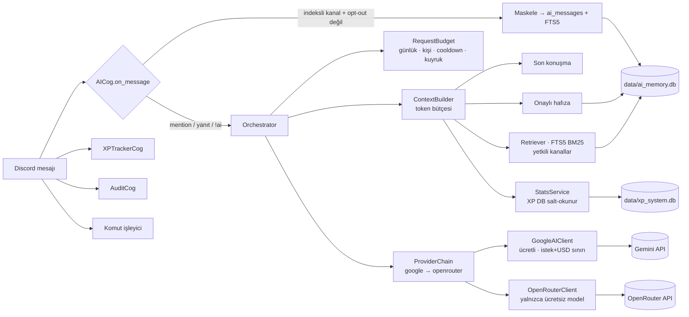

# 🤖 Bot-GAP

<p align="center">
  
</p>

**The Gap** Discord sunucusunun botu. Mesaj ve ses aktivitesine XP verir, seviye rollerini dağıtır, görsel kartlar çizer, kimin kiminle ne kadar seste vakit geçirdiğini tutar ve isteğe bağlı olarak yapay zekâyla sohbet eder.

Bot yalnızca The Gap için yazıldı; herkese açık bir bot olarak yayınlanmak üzere tasarlanmadı.

---

## İçindekiler

- [Özellikler](#-özellikler)
- [Kurulum ve çalıştırma](#-kurulum-ve-çalıştırma)
- [Güncelleme ve yeni sürüm](#-güncelleme-ve-yeni-sürüm)
- [Komutlar](#-komutlar)
- [XP sistemi](#-xp-sistemi)
- [Haftalık özet ve aylık Wrapped](#-haftalık-özet-ve-aylık-wrapped)
- [Başarımlar](#-başarımlar)
- [Yapay zekâ sohbet ve hafıza](#-yapay-zekâ-sohbet-ve-hafıza-isteğe-bağlı)
- [GAP Dünyası (3D Activity)](#-gap-dünyası-3d-activity)
- [Loglama ve hile analizi](#-loglama-ve-hile-analizi)
- [Veri ve yedekleme](#-veri-ve-yedekleme)
- [Geliştirme](#-geliştirme)

---

## ✨ Özellikler

| | |
|---|---|
| 💬 **Mesaj ve ses XP'si** | Mesaj başına rastgele XP (20 sn bekleme), seste 2 dakikada bir XP. Günlük seri ve süreli boost çarpanları. |
| 🏅 **Seviye rolleri** | 19 kademe; XP eşiği geçilince rol otomatik verilir. |
| ⛓️ **Sürgün** | Yöneticilerin XP cezası: süreli ya da kalıcı 0.5x XP, hapishane temalı `!sürgünler` kartı. |
| 🏅 **Başarımlar** | 47 başarım (çoğu Gümüş/Altın/Platin kademeli, bir kısmı gizli), izci fuları kartı, `!kart`'ta 3 rozet. |
| 📊 **Haftalık özet & Wrapped** | Pazar akşamı haftanın, ayın son günü ayın kartı kendiliğinden paylaşılır; herkes kendi kartını da alabilir. |
| 🎴 **Görsel kartlar** | `!kart` profil kartı, `!liderlik` ilk 10, `!roller` rol haritası, `!bf` arkadaşlık kartı. |
| 👥 **Arkadaşlık tier'ları** | Birlikte seste geçirilen süreye göre 6 kademe: Tanıdık → Ruh İkizi. |
| 🧠 **Yapay zekâ** *(isteğe bağlı)* | Etiketlenince cevap verir, onaylı kanallardaki sohbetleri hatırlar, XP verisini bilir, internette arar. |
| 🕵️ **Hile dedektörü** | Makro, tekrar mesaj, sessizde XP kasma gibi durumları log kanalına bildirir. |

---

## 🚀 Kurulum ve çalıştırma

### Docker ile (önerilen)

```bash
git clone https://github.com/talhacuce87/Bot-GAP.git
cd Bot-GAP
cp .env.example .env      # en azından DISCORD_TOKEN'ı doldur
docker compose up -d --build
```

- İmaj `python:3.11-slim` tabanlıdır; sisteme ayrıca bir şey kurmak gerekmez.
- Tüm veri (`xp_system.db`, loglar, yedekler) `./data` klasöründedir. Bu klasör konteynere bağlı olduğu için yeniden deploy'da silinmez.
- Loglar: `docker compose logs -f bot-gap`

### Docker olmadan

Python 3.10 veya üstü gerekir (Docker imajı 3.11 kullanır).

```bash
python -m venv .venv
source .venv/bin/activate        # Windows: .venv\Scripts\activate
pip install -r requirements.txt
python Main.py
```

### `.env`

Tam liste ve açıklamalar `.env.example` içinde. Temel ayarlar:

| Değişken | Gerekli | Açıklama |
|---|---|---|
| `DISCORD_TOKEN` | ✅ | Bot token'ı |
| `BOT_PREFIX` | | Komut ön eki (varsayılan `!`) |
| `LOG_CHANNEL_ID` | | Şüpheli hareket ve admin işlemi uyarılarının gideceği kanal |
| `ANNOUNCE_CHANNEL_ID` | | Yeni sürüm açıldığında güncelleme notlarının paylaşılacağı kanal |
| `SUMMARY_CHANNEL_ID` | | Haftalık özet ve aylık Wrapped kartlarının paylaşılacağı kanal (boşsa `ANNOUNCE_CHANNEL_ID`) |
| `ACHIEVEMENT_CHANNEL_ID` | | Yeni başarımların duyurulacağı kanal (boşsa sessizce açılır) |
| `SUMMARY_POST_HOUR` | | Özetlerin paylaşılacağı saat, Türkiye saati (varsayılan 21) |
| `LOG_FILE_RETENTION_DAYS` / `EVENT_RETENTION_DAYS` | | Log dosyası / olay kaydı saklama süresi (varsayılan 90 / 365 gün) |
| `AI_ENABLED` | | Yapay zekâ eklentisi (varsayılan kapalı). Ayarlar için [Yapay zekâ](#-yapay-zekâ-sohbet-ve-hafıza-isteğe-bağlı) |

Discord Developer Portal'da botun **Server Members Intent** ve **Message Content Intent** izinleri açık olmalı.

---

## 🔄 Güncelleme ve yeni sürüm

**Deploy:**

```bash
git pull
docker compose up -d --build
```

**Yeni sürüm notu yayınlamak için:**

1. `info.py` içinde `BOT_VERSION` ve `LAST_DEPLOY_DATE` değerlerini güncelle.
2. `_build_changelog_embed()` içindeki notları yeni sürüme göre yaz.
3. Deploy et. Bot açılınca sürüm numarası son duyurulandan farklıysa notları `ANNOUNCE_CHANNEL_ID` kanalına **bir kez** paylaşır (`data/announced_version.txt`). Sürüm değişmeden yapılan yeniden başlatmalarda tekrar paylaşmaz.

Herkes son notları `!yenilikler` ile görebilir.

---

## 📌 Komutlar

Tüm komutların kısa listesi Discord'da `!yardim` ile görülebilir.

### Genel

| Komut | Açıklama |
|---|---|
| `!yardim` (`!help`, `!komutlar`) | Komut listesi |
| `!yenilikler` (`!changelog`, `!surum`) | Son sürümün yenilikleri |
| `!feature <istek>` | Özellik önerisi bırakır |
| `!ping` | Bot gecikmesi |

### XP ve kartlar

| Komut | Açıklama |
|---|---|
| `!kart [@üye]` | Seviye, XP, rol ve ilerleme kartı |
| `!karakter [üye]` (`!chibi`) | GAP Dünyası'ndaki chibi karakterin resmi; üye etiket, kullanıcı adı ya da takma adla verilebilir |
| `!xp` | Ayrıntılı XP durumu (metin) |
| `!liderlik` (`!lb`, `!top`) | İlk 10 sıralama kartı |
| `!topxp` | İlk 10 sıralama (metin) |
| `!roller` (`!roles`) | 19 seviye rolünü ve eşiklerini gösteren harita |
| `!streak` | Günlük seri ve çarpan |
| `!sürgünler` | Sürgündekiler, sebepleri ve kalan süreleri (kart) |
| `!haftalik` | Kişisel haftalık özet kartı — yalnızca **pazar**, haftada bir kez |
| `!wrapped` (`!aylik`) | Kişisel aylık Wrapped kartı — yalnızca **ayın son günü**, ayda bir kez |
| `!başarımlar [@üye]` (`!basarimlar`, `!rozetler`) | Başarımlar, izci fuları üzerinde rozetler olarak |
| `!kartdüzen` (`!kartduzen`) | `!kart`'ta görünecek en fazla 3 rozeti seçme menüsü |
| `!başarımrehberi` (`!nasilkazanilir`) | Gizli olmayan başarımların nasıl kazanıldığı, kademe eşikleri ve senin durumun |

### Arkadaşlık

| Komut | Açıklama |
|---|---|
| `!bf [@üye]` | En çok birlikte seste olunan kişi ve tier kartı |
| `!arkadaslar [@üye]` (`!fl`, `!friends`) | En çok vakit geçirilen 10 kişi, tier'larıyla |
| `!tierlar` (`!tiers`) | Tier'lar ve saat eşikleri |

Tier'lar birlikte seste geçirilen süreye göre belirlenir: 🌱 Tanıdık 5 sa · 🤝 Arkadaş 20 sa · 💙 Yakın Arkadaş 50 sa · 💞 Best Friend 100 sa · 🔥 Kanka 250 sa · 👑 Ruh İkizi 500 sa.

### Yönetici

| Komut | Açıklama |
|---|---|
| `!xpekle @üye <miktar> <sebep>` | XP ekler |
| `!xpçıkar @üye <miktar> <sebep>` (`!xpcikar`, `!xpsil`) | XP çıkarır |
| `!xpayarla @üye <miktar> <sebep>` | Toplam XP'yi ayarlar (mesaj/ses oranı korunur) |
| `!boost @üye <çarpan> [saat] <sebep>` | Süreli XP çarpanı (1–10x, en fazla 720 saat) |
| `!sürgün @üye <süre\|kalıcı> <sebep>` (`!surgun`) | Üyeyi sürgüne gönderir; bkz. [Sürgün](#sürgün) |
| `!sürgünsonlandır @üye` (`!surgunsonlandir`) | Sürgünü erken bitirir |
| `!basarimver @üye <başarım> [gümüş\|altın\|platin]` · `!basarimal @üye <başarım>` | Başarım verir (kademe yazılmazsa bir üst kademe) / geri alır |
| `!xpsenkronize` | Tüm üyelerin seviye rollerini XP'lerine göre düzeltir |
| `!yedekle` (`!backup`) | Veritabanının anlık yedeğini alır |

XP komutlarında sebep zorunludur (en az 5 karakter) ve her işlem olay kaydına yazılır. Yapay zekâ komutları için [ilgili bölüme](#komutlar) bak.

---

## 📈 XP sistemi

| Kaynak | Kural |
|---|---|
| **Mesaj** | Mesaj başına rastgele **3–8 XP**, kişi başı **20 sn** bekleme. Komutlar XP vermez. |
| **Ses** | **2 dakikada 1 XP**. Kanalda en az **2 geçerli üye** olmalı. Sağırlaştırılmış (deafen) üyeler, botlar ve AFK kanalı sayılmaz; mikrofon kapalı olmak XP'yi engellemez. |
| **Günlük seri** | O gün yazılan ilk mesaj seriyi ilerletir. Her seri günü mesaj XP'sine **+%2** ekler (en fazla **+%50**). |
| **Seri ödülleri** | 7 gün +50 · 14 gün +120 · 30 gün +300 · 60 gün +700 · 100 gün +1500 XP |
| **Boost** | Yöneticinin verdiği süreli çarpan; mesaj ve ses XP'sine uygulanır. |
| **Balık** | GAP Dünyası'ndaki gölde günde bir balık: nadirliğine göre süreli **2x** boost. Yönetici boost'undan ayrı tutulur, geçerli olan büyük çarpandır. Bkz. [Gölde balık tutma](#gölde-balık-tutma). |
| **Sürgün** | Sürgündeki üye tüm XP'yi sabit **0.5x** kazanır; boost ve seri çarpanı yok sayılır. |

Seviye, toplam XP'nin geçtiği rol eşiğidir: 0, 150, 400, 800, 1.400, 2.300, 3.500, 5.200, 7.600, 10.500, 14.500, 19.500, 25.500, 32.500, 40.000, 100.000, 250.000, 500.000 ve 1.000.000 XP (19 seviye). Eşik geçilince rol otomatik verilir; `!roller` haritayı gösterir.

### Sürgün

Yöneticilerin XP cezası. `!sürgün @üye <süre> <sebep>` ile verilir.

- **Süre:** `30dk`, `12sa`, `3g`, `1hafta`, `1ay`, birleşik `1g12sa` ya da sadece sayı (saat). En fazla 365 gün. `kalıcı` yazılırsa bir yönetici `!sürgünsonlandır` ile kaldırana kadar sürer.
- **Ceza:** Mesaj ve ses XP'si sabit **0.5x** olur; aktif boost ve seri çarpanı hesaba katılmaz. Küsurat birikir (ör. seste 4 dakikada 1 XP).
- **Seri donar:** Sürgünde seri ne ilerler ne bozulur, ödül de vermez. Ceza bitince kaldığı günden ve çarpandan devam eder.
- **Bitiş:** Süre dolunca bot dakikada bir kontrol edip cezayı kendisi kaldırır ve sürgünün verildiği kanalda haber verir. Erken bitirmek için `!sürgünsonlandır @üye`.
- Zaten sürgündeki birine tekrar `!sürgün` yazılırsa süre ve sebep güncellenir.
- `!sürgünler` herkesin görebildiği hapishane temalı bir kart çizer: sabıka fotoğrafı, sebep, sürgün eden yönetici, kalan süre ve çekilen cezanın çubuğu (kalıcılar kırmızı).
- Sürgün verme, güncelleme ve bitirme işlemleri olay kaydına ve log kanalına yazılır.

---

## 📊 Haftalık özet ve aylık Wrapped

Bot, olay kaydındaki veriden (XP, mesajlar, ses XP'si ve o sırada seste kimlerin olduğu, seviye atlamaları) dönem özetleri çıkarır. Saatler Türkiye saatidir.

- **Otomatik paylaşım:** Her **pazar 21:00**'de haftanın kartı (pazartesi 00:00'dan itibaren), **ayın son günü 21:00**'de ayın Wrapped kartı `SUMMARY_CHANNEL_ID` kanalına (boşsa `ANNOUNCE_CHANNEL_ID`) gider. Bot o saatte kapalıysa aynı gün açılınca gönderir. Her dönem **bir kez** paylaşılır (`data/summary_state.json`).
- **Sunucu kartı:** Dönemin MVP'si (en çok XP) ve ilk 4, seste en çok kalan, en çok yazan, dönemin ikilisi (birlikte en çok seste kalan iki kişi), en uzun seri, gece kuşu (00:00–05:00 arası en çok yazan), seviye atlayanlar, toplam mesaj/ses ve en hareketli gün-saat.
- **Kişisel kart:** `!haftalik` yalnızca **pazar**, `!wrapped` yalnızca **ayın son günü** çalışır ve herkes dönemde **bir kez** alabilir. Başka günlerde bot bir sonraki tarihi söyler. Kartta: kazanılan XP ve sunucudaki sıra, mesaj ve ses süresi, en çok takıldığın kişi, en aktif saat ve gün, seviye değişimi, seri ve dönemin "hâli" (Gece Kuşu, Sosyal Kelebek, Ses Bağımlısı, Klavye Delikanlısı, Sessiz Gölge, Dengeli Gapçı).
- Ses süresi, ses XP'si kazanılan süredir: yanında en az bir kişi varken, sağır değilken ve AFK kanalında değilken.

---

## 🏅 Başarımlar

47 başarım var. Kademeli olanlar **Gümüş → Altın → Platin** ilerler, tek kademeliler açılınca "Özel" olur. Kademe hiçbir zaman düşmez.

- **`!başarımlar [@üye]`:** Rozetler kartı çaprazlama geçen bir izci fuları üzerinde görünür. Açılanlar işlemeli ve kademe renginde, kilitliler soluk, **gizli** kilitliler "???" olur. Sağ üstte "sıradaki hedefler" ve ilerleme çubukları yer alır.
- **`!kartdüzen`:** Kazanılan başarımlardan en fazla **3**'ü bir menüden seçilir; `!kart`'taki "Badges" kutusunda görünür.
- **Gizli başarımlar:** Spam'e açık olan başarımlar (mesaj, dosya, sticker, yanıt, düzenleme, takma ad…) gizlidir. Açılana kadar adı ve koşulu görünmez, böylece kasılamaz.
- **Spam koruması:** Kapıyı Açan, ancak boş kanalı açtıktan sonra 30 dakika içinde biri gelirse sayılır. Işıkları Kapatan, ancak kanalda biriyle birlikte olunduysa sayılır. Kalabalık Sever günde en fazla bir kez sayılır. Günaydın, 08:00'den sonra sunucuda o günün ilk mesajını atana verilir. Islah Oldum yalnızca aralıksız en az 10 saat süren bir sürgünden sonra 30 gün temiz kalana verilir.
- **Koleksiyon:** Koleksiyoncu ve Platin Avcısı diğer başarımlara bakar; kendileri sayılmaz.
- **Özel günler:** Gap'in Doğum Günü, sunucunun Discord'daki kuruluş tarihinin yıldönümünde; Atatürk'ün Evlatları, 29 Ekim'de seste olanlara verilir.
- **Hesaplama:** Başarımlar olay kaydından 5 dakikada bir hesaplanır. İlk çalıştırmada geçmiş kayıt geriye dönük işlenir ve bu ilk açılışlar duyurulmaz. `ACHIEVEMENT_CHANNEL_ID` ayarlıysa sonraki yeni başarımlar orada duyurulur (üyenin adı vurgulanır, ping gitmez).
- **`!başarımrehberi`:** Gizli olmayan başarımların koşulları, kademe eşikleri ve kullanıcının hangilerine sahip olduğu listelenir. Gizliler sadece sayı olarak görünür.
- **Yönetici:** `!basarimver @üye <başarım> [kademe]` her başarımı verir. Kademe yazılmazsa bir üst kademe verilir; Fikir Babası yalnızca böyle açılır. Yanlış verilen bir başarım `!basarimal` ile geri alınır. Başarım adlarında Türkçe karakter ve büyük/küçük harf fark etmez (`fikir babasi`, `yayinci altin`).
- **Komut yazımı:** Tüm komutlar Türkçe karakterli ya da karaktersiz yazılabilir (`!başarımlar`, `!basarimlar`, `!basarımlar`).
- **Bayram tarihleri:** Bayram Ziyareti, `achievements.py` içindeki Diyanet bayram tarihlerini kullanır (2028 sonrası tahminidir).

| Kategori | Başarım | Koşul | Kademeler (Gümüş / Altın / Platin) |
|---|---|---|---|
| Ses | **Ses Kurdu** | Toplam N saat seste | 250 / 1.000 / 2.000 saat |
| Ses | **Maraton** | Tek seferde aralıksız N saat seste | 12 / 17 / 24 saat |
| Ses | **Gece Nöbeti** | 03:00–05:00 arası toplam N saat seste | 25 / 50 / 150 saat |
| Ses | **Kalabalık Sever** | 10+ kişilik seste N farklı gün bulunmak | 10 / 50 / 150 gün |
| Ses | **Yayıncı** | Seste N saat ekran paylaşımı | 100 / 250 / 500 saat |
| Ses | **Yüzümüz Ortada** | Kamerası açık N saat seste | 5 / 25 / 100 saat |
| Ses | **Kulak Misafiri** | Mikrofonu kapalı N saat seste | 50 / 200 / 500 saat |
| Ses | **Kapıyı Açan** | Boş ses kanalını N kez açıp arkadaşlarını beklemek | 40 / 150 / 400 |
| Ses | **Işıkları Kapatan** | Bir muhabbetten N kez en son çıkan olmak | 40 / 150 / 400 |
| Sohbet | **Klavye Ustası** | XP kazandıran N mesaj | 1.000 / 5.000 / 20.000 |
| Sohbet | **Günaydın** | 08:00'den sonra sunucudaki günün ilk mesajını N kez atmak | 10 / 50 / 150 |
| Sohbet | **Sabahçı** | 08:00–10:00 arası N mesaj | 100 / 500 / 1.500 |
| Arkadaşlık | **Ayrılmaz İkili** | Aynı kişiyle bir haftada 30+ saat seste | Tek |
| Arkadaşlık | **Üç Silahşörler** | Aynı üç kişi birlikte N saat seste | 50 / 200 / 500 saat |
| Arkadaşlık | **Herkesin Kankası** | 5 farklı kişiyle Arkadaş tier'ına ulaşmak | Tek |
| Arkadaşlık | **Sosyal Kelebek** | N farklı kişiyle en az 5'er saat seste | 15 / 20 / 30 kişi |
| Arkadaşlık | **Hoş Geldin Komitesi** | Yeni gelen N kişiyle ilk 30 gününde 5'er saat seste | 1 / 5 / 10 kişi |
| İlerleme | **Ateşli Seri** | N günlük seri | 7 / 30 / 100 gün |
| İlerleme | **Yükselen Yıldız** | Seviye N | 5 / 10 / 15 |
| İlerleme | **Koleksiyoncu** | N başarım toplamak | 10 / 20 / 30 |
| İlerleme | **Platin Avcısı** | N başarımda Platin kademe | 3 / 7 / 10 |
| Özet | **Haftanın MVP'si** | N kez haftanın MVP'si olmak | 1 / 5 / 15 |
| Özet | **Haftanın İkilisi** | N kez haftanın ikilisi olmak | 1 / 5 / 15 |
| Özet | **Haftanın Gece Kuşu** | N kez haftanın gece kuşu olmak | 1 / 5 / 15 |
| Özet | **Wrapped Yıldızı** | N kez ayın MVP'si olmak | 1 / 3 / 6 |
| Sadakat | **Gap Emektarı** | Sunucuda N yıl | 1 / 2 / 3 yıl |
| Sadakat | **Sadık** | Son 365 günün 300'ünde aktif olmak | Tek |
| Sadakat | **Diriliş** | Bozulan seriyi yeniden 14 güne çıkarmak | Tek |
| Sadakat | **Sunucu Destekçisi** | Sunucuya N ay boost | 3 / 6 / 12 ay |
| Özel Gün | **Yılbaşı Gecesi** | Yılbaşı gecesi (23:30–00:30) seste olmak | Tek |
| Özel Gün | **Bayram Ziyareti** | Bayramın ilk günü seste olmak | Tek |
| Özel Gün | **Atatürk'ün Evlatları** | 29 Ekim'de seste olmak | Tek |
| Özel Gün | **Gap'in Doğum Günü** | Sunucunun kuruluş yıldönümünde seste olmak | Tek |
| Özel | **Fikir Babası** | Önerdiği bir özelliğin bota gelmesi | Tek |

Bunlara ek olarak **13 gizli başarım** var; adları ve koşulları açılana kadar görünmez (tanımlar `achievements.py` içinde).

Rozet simgeleri [Twemoji](https://github.com/jdecked/twemoji)'dendir (CC-BY 4.0), bkz. `assets/badges/KAYNAK.md`.

---

## 🧠 Yapay zekâ sohbet ve hafıza (isteğe bağlı)

Bot, Google AI Studio (Gemini, ücretli) ve/veya OpenRouter'ın **ücretsiz** modelleriyle konuşabilir ve onaylı kanallardaki sohbetleri hatırlayabilir. `AI_ENABLED=false` (varsayılan) iken hiçbir AI kodu yüklenmez.

### Kurulum

1. Bir sağlayıcı anahtarı al: https://openrouter.ai/keys (ücretsiz modeller) ve/veya Google AI Studio (ücretli).
2. `.env` dosyasına ekle:
   ```env
   AI_ENABLED=true
   OPENROUTER_API_KEY=sk-or-v1-...
   OPENROUTER_MODEL=google/gemma-4-31b-it:free
   OPENROUTER_FALLBACK_MODEL=nvidia/nemotron-3-super-120b-a12b:free,openrouter/free
   # İsteğe bağlı, ücretli:
   GOOGLE_AI_API_KEY=...
   ```
3. Botu yeniden deploy et.
4. Sunucuda bir yönetici, hafızayı açmak istediği kanalda `!aiayar kanal ekle` yazar. Bot kanala bir bilgilendirme mesajı bırakır.
5. `!aidurum` ile modeli ve kotayı kontrol et.

### Komutlar

**Kullanıcı:**
- Sohbet: `@Bot-GAP <mesaj>` · `!ai <mesaj>` · `/ara <soru>` / `!ara <soru>` (internet araması, cevap yalnızca sana)
- Hafıza: `!hatirla <konu>` (LLM kotası harcamaz) · `!hafizam` (DM) · `!hafizaekle <bilgi>` · `!onayla <id>` · `!unut <id>` · `!unuttur [onay]`
- Diğer: `!aigizlilik [ac|kapat]` · `!ani <metin> [@üyeler]` · `!anilar` · `!aiyardim` · `!aidurum`

**Yönetici:** `!aiayar` (durum) · `!aiayar ac|kapat` · `!aiayar kanal ekle|cikar [#kanal]` · `!aiayar mod mention|command` · `!aiayar cooldown <sn>` · `!aiayar saklama <gün>` · `!aiayar bakim` · `!aiayar yedekle`. Tüm ayar değişiklikleri olay kaydına `admin_ai_*` olarak yazılır.

"Kim en yüksek seviyede?", "seviyem kaç?", "best friend'im kim?" gibi sorular XP veritabanından **salt-okunur** cevaplanır; model kullanılamazsa bu veriler doğrudan gösterilir.

### Sağlayıcılar ve maliyet

**Google AI Studio (ücretli):** `GOOGLE_AI_API_KEY` verilince birincil sağlayıcı olur (`AI_PROVIDER_ORDER=google,openrouter`); hata, kota ya da bütçe dolunca OpenRouter'a düşülür. Faturalandırması açık bir projenin anahtarıyla **her istek ücretlendirilir**.

- Varsayılan model `gemini-3.8-flash`: 1M giriş/çıkış token başına $0.75 / $3.75 (1 Ocak 2027'den itibaren $1.50 / $7.50). Tipik bir cevap ~$0.0015–0.0025. Gemini 3+ modellerinde düşünme kapatılamaz, `minimal` seviyede çalışır ve düşünme tokenları çıktı olarak ücretlendirilir.
- Daha ucuz alternatifler: `gemini-3.1-flash-lite` (~$0.0005/cevap), `gemini-2.5-flash-lite` (~$0.0002/cevap, düşünme kapalı).
- **Sert günlük sınırlar** (UTC gün, yeniden başlatmada korunur): `GOOGLE_AI_DAILY_REQUEST_BUDGET` (varsayılan 1000) ve `GOOGLE_AI_DAILY_COST_LIMIT_USD` (varsayılan $5). Biri dolunca Google o gün kullanılmaz.
- Maliyet, yanıttaki token sayıları × `GOOGLE_AI_PRICE_*_PER_M` ile **tahmin** edilir (Google bu uç noktada ücret bildirmez). Kesin fatura için Google Cloud Console → Billing; orada bir **bütçe uyarısı** kurman önerilir.
- Hatalar: dakikalık 429 → `retryDelay` kadar bekleyip tekrar (30 sn'den uzunsa yedeğe geçer); günlük kota 429 → model 15 dk soğumaya alınır; geçersiz anahtar → Google 30 dk devre dışı.

**OpenRouter (ücretsiz):**

- Varsayılan model `google/gemma-4-31b-it:free` (akıl yürütme kapalı, Türkçesi iyi). `openrouter/free` her istekte rastgele bir ücretsiz modele gider; bunların bazıları düşünme metnini cevaba sızdırdığı için yalnızca yedek olarak önerilir. Bot akıl yürütmeyi kapatır (`AI_REASONING_EFFORT=none`), `<think>` bloklarını siler ve düşünme metni gibi görünen cevapları göndermeden yeniden dener.
- Bot açılışta ve 6 saatte bir model fiyatlarını doğrular. Fiyatı `0` olmayan model (değişken fiyatlı `openrouter/auto` dahil) `AI_ALLOW_PAID_MODELS=true` olmadıkça **asla** çağrılmaz. İsteklere `provider.max_price = 0` eklenir; yanıtta ücret bildirilirse sağlayıcı kapatılır.
- Sağlayıcı yoğunken (429) aynı model tekrar denenmez: model 2 dk (ya da `Retry-After` kadar, en çok 15 dk) soğumaya alınır ve sıradaki yedeğe geçilir. Bu yüzden yedek olarak farklı sağlayıcıdaki bir model seçmek önemlidir.
- Ücretsiz kota (2026-10 itibarıyla): dakikada 20, günde 50 istek (hesaba toplam 10$+ kredi yüklenmişse günde 1000). `AI_DAILY_REQUEST_BUDGET` bunun altında tutulmalı.
- Ücretsiz modeller zamanla kaldırılabilir; `!aidurum` hata gösterirse modeli güncelle.

### Araçlar ve internet araması

Gemini kullanılırken model, isteğe göre hangi aracı çağıracağına kendisi karar verir (en fazla 4 tur, her tur bütçeden düşer):

| Araç | Ne yapar |
|---|---|
| `get_server_info`, `list_roles`, `get_role_members`, `list_channels`, `get_voice_activity`, `get_member_profile` | Discord bilgisi (yalnızca soranın görebildiği) |
| `get_leaderboard`, `get_member_stats`, `get_best_friend` | XP, seviye, seri, ses ve arkadaşlık verisi (salt-okunur) |
| `search_chat_history` | Hafızası açık, yetkili kanallarda geçmiş arama (kaynak linkleriyle) |
| `save_user_memory` | Kullanıcı açıkça "hatırla" dediyse kaydeder; aksi halde yalnızca aday |
| `web_search` | Google Search; cevap yalnızca soran kişiye iletilir |

Araç desteklemeyen modellere (OpenRouter yedekleri) düşülürse uygulama soruya göre veriyi önceden toplayıp modele verir. `AI_TOOLS_ENABLED=false` ile araçlar kapatılabilir.

- **`/ara`:** Google'ın [Gemini API koşulları](https://ai.google.dev/gemini-api/terms) arama sonuçlarının yalnızca soran kişiye gösterilmesini ve saklanmamasını şart koşar. Bu yüzden slash komutunda cevap gizli mesaj, prefix komutunda DM olarak gelir; herkese açık kanala yazılmaz ve hafızaya kaydedilmez.
- Arama ücreti: ayda 5000 arama ücretsiz, sonrası $14 / 1000 arama. Bot her aramayı `GOOGLE_AI_SEARCH_PRICE_PER_1000` ile USD sınırına ekler. Günlük sınır: `GOOGLE_AI_DAILY_SEARCH_BUDGET` (varsayılan 100).
- Slash komutlarının Discord'da görünmesi için bot bir kez `AI_SLASH_SYNC=true` ile başlatılmalı.
- Çevrimiçi üye sayısı bilinemez (botta Presence Intent yok).

### Gizlilik ve saklama

- Kanal indeksleme **varsayılan kapalı**. Yalnızca `!aiayar kanal ekle` ile açılan kanallardaki, komut ve bot olmayan mesajlar saklanır. DM'ler asla saklanmaz.
- E-posta, telefon, IBAN, kart numarası, TC kimlik, token/API anahtarı ve "şifrem: …" kalıpları kaydedilmeden önce `[gizlendi]` ile maskelenir.
- Geçmiş arama **o anki** Discord izinlerine göre yapılır: kanal hem soran üye tarafından okunabilmeli hem de ya cevabın verildiği kanal olmalı ya da @everyone'a açık olmalı. Böylece özel kanal içeriği başka bir kanala sızmaz.
- Silinen mesajın içeriği hemen silinir. Tek kaynağı silinen, onaylanmamış hafızalar iptal edilir.
- Otomatik çıkarılan bilgiler ("en sevdiğim oyun X") yalnızca **aday** olur; kullanıcı `!onayla` demedikçe kullanılmaz.
- Sağlayıcıya yalnızca o istek için seçilmiş kısa bağlam gönderilir. Sağlayıcılar veriyi kendi koşullarına göre işleyebilir (ücretsiz katmanlarda eğitim amaçlı kullanım dahil olabilir).
- Mesajlar varsayılan 30 gün saklanır (sunucu bazında değiştirilebilir); bakım 6 saatte bir çalışır.
- Not: `AuditCog` tüm komutların ilk 200 karakterini olay kaydına yazar; bu `!ai` sorularını da kapsar (`EVENT_RETENTION_DAYS` ile sınırlı).

### Mimari



`ai/` paketi: `config` (env) · `storage` (SQLite) · `migrations` · `openrouter` / `google` (sağlayıcılar) · `providers` (zincir) · `budget` (kota) · `guard` (güvenlik/gizlilik) · `retrieval` (FTS5) · `context` (prompt) · `memory` (hafıza politikası) · `stats` (Bot-GAP verisi) · `persona` · `orchestrator` · `cog` (Discord). Botun kişiliği `persona/default.md` dosyasından düzenlenebilir.

<details>
<summary><b>Tüm AI ortam değişkenleri</b></summary>

| Değişken | Varsayılan | Açıklama |
|---|---|---|
| `AI_ENABLED` | `false` | Eklentiyi aç/kapat |
| `GOOGLE_AI_API_KEY` | – | Google AI Studio anahtarı (loglanmaz; **ücretli olabilir**) |
| `GOOGLE_AI_MODEL` / `GOOGLE_AI_FALLBACK_MODEL` | `gemini-3.8-flash` / – | Google modeli ve virgülle ayrılmış yedekleri |
| `GOOGLE_AI_DAILY_REQUEST_BUDGET` / `GOOGLE_AI_DAILY_COST_LIMIT_USD` | `1000` / `5` | Google için sert günlük sınırlar |
| `GOOGLE_AI_PRICE_INPUT_PER_M` / `GOOGLE_AI_PRICE_OUTPUT_PER_M` | `0.75` / `3.75` | Maliyet tahmini için birim fiyat (USD/1M token) |
| `GOOGLE_AI_MAX_OUTPUT_TOKENS` | `800` | Google yanıt sınırı (düşünme dahil) |
| `GOOGLE_AI_REASONING_EFFORT` | `auto` | `auto` / `none` / `minimal` / `low` … / `off` (gönderme) |
| `AI_PROVIDER_ORDER` | `google,openrouter` | Sağlayıcı sırası |
| `AI_WEB_SEARCH_ENABLED` | `true` | `/ara` internet araması (Google anahtarı gerekir) |
| `GOOGLE_AI_DAILY_SEARCH_BUDGET` / `GOOGLE_AI_SEARCH_PRICE_PER_1000` | `100` / `14` | Günlük arama sınırı ve arama başı maliyet tahmini |
| `AI_DISCORD_INFO_ENABLED` | `true` | Sunucu/rol/kanal/ses/üye bilgisini modele ver |
| `AI_TOOLS_ENABLED` | `true` | Modelin araç çağırmasına izin ver (Gemini) |
| `OPENROUTER_API_KEY` | – | OpenRouter anahtarı (loglanmaz) |
| `OPENROUTER_MODEL` | `google/gemma-4-31b-it:free` | Birincil model |
| `OPENROUTER_FALLBACK_MODEL` | – | Virgülle ayrılmış yedek modeller (yalnızca ücretsizler) |
| `AI_ALLOW_PAID_MODELS` | `false` | Ücretli modellere izin |
| `AI_ENFORCE_ZERO_PRICE` | `true` | İsteğe `provider.max_price=0` ekle |
| `AI_MAX_OUTPUT_TOKENS` | `350` | Yanıt token sınırı |
| `AI_CONTEXT_TOKEN_BUDGET` | `3000` | Yaklaşık prompt bütçesi |
| `AI_MAX_CONCURRENT_REQUESTS` / `AI_MAX_QUEUE_SIZE` | `1` / `4` | Eşzamanlılık ve bekleme kuyruğu |
| `AI_REQUEST_TIMEOUT_SECONDS` / `AI_TOTAL_DEADLINE_SECONDS` | `45` / `90` | Deneme ve toplam süre sınırı |
| `AI_MAX_RETRIES` / `AI_MAX_RETRY_WAIT_SECONDS` | `2` / `30` | Yeniden deneme sayısı ve en uzun bekleme |
| `AI_REASONING_EFFORT` | `none` | `none` = akıl yürütme kapalı (önerilen); `low`/`medium`/`high` = açık ama gizli; boş = gönderme |
| `AI_RESPONSE_MODE` | `mention` | `mention` veya `command` (sadece `!ai`) |
| `AI_MEMORY_ENABLED` | `true` | Uzun süreli hafıza |
| `AI_INDEXING_DEFAULT` | `false` | `true` → tüm metin kanalları varsayılan indekslenir (önerilmez) |
| `AI_MESSAGE_RETENTION_DAYS` | `30` | Mesaj saklama (sunucu bazında `!aiayar saklama`) |
| `AI_CANDIDATE_RETENTION_DAYS` | `14` | Onaylanmamış aday hafıza ömrü |
| `AI_DAILY_REQUEST_BUDGET` | `35` | OpenRouter günlük istek (UTC; her HTTP denemesi sayılır) |
| `AI_USER_DAILY_REQUEST_LIMIT` | `0` | Kişi başı günlük cevap sınırı (0 = sınırsız) |
| `AI_CHANNEL_COOLDOWN_SECONDS` / `AI_USER_COOLDOWN_SECONDS` | `1` / `1` | Kanal / kişi başı bekleme (sn) |
| `AI_RECENT_CONTEXT_MESSAGES` | `25` | Kısa süreli bağlam penceresi |
| `AI_SEARCH_RESULTS` / `AI_FINAL_PASSAGES` / `AI_NEIGHBOR_MESSAGES` | `10` / `5` / `2` | Geçmiş arama sınırları |
| `AI_SLASH_SYNC` | `false` | Açılışta slash komutlarını kaydet |
| `AI_DB_PATH` / `AI_PERSONA_DIR` | `data/ai_memory.db` / `persona/` | Yol değiştirme |

</details>

<details>
<summary><b>Sorun giderme</b></summary>

| Belirti | Neden / çözüm |
|---|---|
| "AI yapılandırılmamış" | `OPENROUTER_API_KEY` boş |
| "yapılandırma hatası… devre dışı" | Anahtar 401/403 aldı; 30 dk sonra ya da yeniden başlatınca tekrar denenir. Anahtarı kontrol et |
| "ücretsiz olarak doğrulanamadı" | Model ücretli, değişken fiyatlı ya da listede yok; `:free` bir model seç |
| "Bugünlük … kota doldu" | Yerel bütçe ya da OpenRouter günlük kotası; UTC gece yarısı sıfırlanır |
| "Model boş yanıt döndü" | Model düşünmeye token harcadı ya da düşünme metni sızdırdı. `AI_REASONING_EFFORT=none` olduğundan ve `OPENROUTER_MODEL`'in `openrouter/free` olmadığından emin ol |
| Sürekli 404 / "No endpoints" | Model kaldırılmış olabilir ya da `AI_ENFORCE_ZERO_PRICE=false` dene |
| `!hatirla` sonuç vermiyor | Kanal indekslenmiyor (`!aidurum`) ya da farklı kelimelerle konuşulmuş |
| AI veritabanı hatası (`!aiayar`) | `data/` izinlerini ve disk alanını kontrol et |

Loglar `data/logs/bot.log` içinde (`gap.ai.*`). API anahtarları ve prompt içerikleri loglanmaz.

**Geri alma:** Hızlı yol `.env`'de `AI_ENABLED=false` yapıp `docker compose up -d` (AI verisi diskte kalır). `data/ai_memory.db*` dosyaları XP verisinden bağımsızdır, istenirse silinebilir.

</details>

<details>
<summary><b>Bilinen sınırlar</b></summary>

- Geçmiş arama sözcükseldir (FTS5 + Türkçe harf katlama + temkinli ek kırpma). Eşanlamlılar ("maç" ↔ "karşılaşma") bulunmaz.
- Token sayımı yaklaşıktır (~3 karakter/token).
- Thread'ler ancak thread'in kendisi `!aiayar kanal ekle` ile açılırsa indekslenir.
- Hafıza çıkarımı birkaç basit kalıpla sınırlıdır ve şakayı ayırt edemez (bu yüzden aday olarak kalır).
- Ücretsiz modellerin kalitesi ve kotası OpenRouter'a bağlıdır ve değişebilir.
- Bellek: AI kapalı ~54 MB, AI açık boşta ~57 MB (gateway bağlantısı olmadan ölçüldü). Gerçek sunucuda üye önbelleği nedeniyle daha yüksek olur; hedef toplam 150–350 MB.
- Planlanan: semantik arama, LLM ile hafıza özetleme. Sesli kanal ve görsel girdi kapsam dışı.

</details>

---

## 🌍 GAP Dünyası (3D Activity)

Ses kanalındakilerin Discord içinde avatar olarak buluştuğu low-poly 3D dünya (`web/`). Bottan bağımsız ikinci bir servis olarak çalışır. Öncelik her cihazda 60 fps: tüm sahne ~12 draw call'dan oluşur, gerçek zamanlı gölge kullanılmaz, kare düşerse çözünürlük kendiliğinden azalır.

**Yerel geliştirme**

```bash
cd web
npm install
npm run dev        # http://localhost:5173  (Vite + sunucu)
npm test           # vitest
```

Tarayıcıda Discord olmadan misafir olarak açılır. Kullanılabilecek parametreler:

| Parametre | İşlevi |
|---|---|
| `?room=ad` | Ayrı bir oda açar |
| `?name=Ali` | İsim belirler |
| `?debug=1` | fps / draw call paneli ve YouTube testi |
| `?bots=20` | 20 sahte oyuncu ekler (performans testi) |
| `?low` | Kenar yumuşatmayı (antialias) kapatır |
| `?noadapt` | Çözünürlüğü sabit tutar |
| `?jail=1` | Misafiri zindana koyar (zindan testi) |
| `?debug=1&at=x,z` | Belirtilen noktada başlatır |

Gardırop normalde Discord girişi ve bot ister. Yerelde denemek için sunucuyu `WORLD_DEV_WARDROBE=1 npm run dev` ile başlat (PowerShell: `$env:WORLD_DEV_WARDROBE="1"; npm run dev`): misafir de gardırobu açar, bütün parçalar kilitsizdir, kayıt yalnızca sunucu açıkken bellekte tutulur. Canlıda tanımlama.

**Bölgeler:**
- **Meydan:** Çeşme, doğma noktası ve yön tabelası.
- **Sinema:** Kuzeyde. 20 m'lik perde ve 6 sıralık amfi.
- **Zindan:** Batıda. `!sürgün` ile cezalandırılanlar dünyaya girince hücrede doğar ve çıkamaz. Ceza bitince parmaklıkların önüne çıkarılır; bot listeyi 20 sn'de bir, komut verildiğinde ise hemen dünyaya gönderir (`world_cog.py`). Bunun için iki serviste de aynı `WORLD_SHARED_SECRET` tanımlı olmalı.
- **LAGER'in Mangalı:** Doğuda, ormanın içinde. Mangal, kütük oturaklar, piknik masası ve ışık zinciri var.
- **Gölet:** Güneyde, kenarında bir bank var. Gölde ördekler yüzer; kenarında F ile günde bir balık tutulur (aşağıda).
- **Tank:** Meydanın kuzeybatısındaki beton park yerinde (yön tabelasında "↖ TANK"). Odada tek tank var; boşken yanında **F** ile binilir. W/S ileri-geri, A/D gövdeyi döndürür, kule kameranın baktığı yöne döner, **Space** ateş eder (1.5 sn bekleme), **F** ile inilir. Can yok: mermi değdiği kişiyi ya da patlamanın 3.6 m çevresindekileri savurur. Mermiyi sunucu hesaplar (`web/shared/tank.ts`); ağaç ve duvarlardan geçer. Sürücüsüz tank 10 dakika sonra park yerine döner. Sürgündekiler binemez, sürücü sürgüne giderse tanktan indirilir.
- **Tank Savaşı:** Dünyada sağ üstteki ⚔️ düğmesi ya da sohbette `!savaş` (`!tank`) ayrı bir savaş odası açar (aynı Activity'deki herkes aynı odaya düşer; test için `?battle=1`). Herkes tankta: Kırmızı ya da Mavi takımı seç (takımlar en fazla 1 kişi farkla dengelenir). Her tankın 3 canı var; doğrudan isabet ya da patlamanın 2.4 m yakını 1 hasar, dost ateşi yok. Vurulan tank 5 sn sonra üssünde doğar. Her takımda en az 1 kişi olunca 5 sn geri sayım, ardından 5 dakikalık maç: en çok vuran takım kazanır, sonuç 12 sn gösterilir ve yeni maç başlar. Arenadaki kaya, kasa ve kum torbası siperleri mermiyi durdurur (`web/shared/arena.ts`, kurallar `web/server/src/battle.ts`). 🏠 düğmesi dünyaya döndürür. Ödül yok.
- **Sakura Bahçesi:** Kuzeydoğuda, torii kapıdan girilir. Gür çimen, sakura ağaçları, gece loş yanan taş fenerler, ortadaki büyük sakuraya bakan iki bank. İçeri girince ekran pembe parlayıp söner, yukarıdan sakura yaprakları süzülür, esinti ve rüzgâr çanı sesi gelir (ses Web Audio ile üretilir). Yürürken yerdeki yapraklar ayağının dibinde havalanır. Yoğunluk ve boyutlar `web/client/src/world/sakura.ts` içindeki `SAKURA_CONFIG`'te.
- **Şöhret Kürsüsü:** Meydanın güneybatısında. XP sıralamasının ilk 10'u bir panoda gösterilir; önündeki podyumda ilk 3 için altın, gümüş ve bronz heykeller durur. Bot sıralamayı dakikada bir gönderir, pano sayfa yenilenmeden güncellenir.

#### Gölde balık tutma

Gölün kenarında **F · Balık tut 🎣**. Türkiye saatiyle günde bir kez; zar botta atılır (`fishing.py`), dünya yalnızca gölün yanında olup olmadığını doğrular. Misafirler ve sürgündekiler tutamaz.

| Nadirlik | Balık | İhtimal | Ödül |
|---|---|---|---|
| Yaygın | Sazan | %70 | 1 saat 2x XP |
| Az Bulunur | Kızılkanat | %20 | 2 saat 2x XP |
| Nadir | Turna | %7.5 | 4 saat 2x XP |
| Epik | Yayın Balığı | %2 | 8 saat 2x XP |
| Efsanevi | Altın Sazan | %0.5 | 24 saat 2x XP |

- **Şans serisi:** Art arda balık tutulan her gün efsanevi ihtimalini **+%0.1** artırır (fark yaygından düşülür), en fazla **%5**'e kadar. Bir gün atlanırsa seri sıfırlanır.
- **Boost:** Yeni balığın süresi süren balık boost'unun üstüne eklenir. Yöneticinin `!boost`'u ayrı tutulur; ikisinden büyük çarpan geçerlidir, `!xp`'de görünür.
- **Discord duyurusu:** `FISH_CHANNEL_ID` ayarlıysa nadir ve üstü balıklar o kanalda duyurulur (ör. `🌟 EFSANEVİ! @üye gölden Efsanevi Altın Sazan çıkardı! ⚡ 24 saat 2x XP · 🔥 12 günlük seri`). Üyenin adı vurgulanır ama bildirim (ping) gitmez. Eşik `FISH_ANNOUNCE_MIN_RARITY` ile değişir.
- **Kayıt:** Her tutuş olay kaydına `fish_catch` olarak düşer; XP kayıtlarındaki `boost_src` boost'un balıktan mı (`fish`) yöneticiden mi (`admin`) geldiğini gösterir.
- **Kurulum:** Dünya, botun iç HTTP ucuna (`BOT_INTERNAL_URL`, varsayılan `http://bot-gap:8081`) `WORLD_SHARED_SECRET` ile istek atar.

#### Chibi karakterler

Her üyenin kendi chibi karakteri var: 22 saç, 30 üst, 16 alt, 8 ayakkabı, 12 şapka, 6 gözlük, 7 sakal/bıyık, ten/saç/göz rengi. `!karakter [üye]` karakterin resmini Discord'a çizer (`chibi_render.py`, GPU gerekmez).

- **Paket:** Ham model paketi (`chibi_asset_pack_v8/`, 155 MB) repoya girmez. `cd web && npm run bake:chibi -- <paket klasörü>` her parçayı tek ağa birleştirir, renkleri köşelere gömer ve sadeleştirir; çıktı ~4 MB `chibi.{json,bin}`, aynısı `assets/chibi/` (bot) ve `web/client/chibi/` (dünya) altına yazılır. İkisinin aynı olduğunu test denetler.
- **Kurallar** (`outfit.py`): bilinmeyen ya da yanlış slottaki parça varsayılana döner; tek parça üst (elbise, gelinlik, yeniçeri) altı gizler; şapka takınca saç bastırılır. `LOCKED` tablosundaki parçalar seviyeyle açılır: Level Up Tişört 5, XP Hoodie 10. Seviye düşerse parça yine varsayılana döner.
- **Dünyada:** Kameraya yakın avatarlar (masaüstünde 28 kişi / 40 m, zayıf cihazda 14 / 26 m) chibi, uzaktakiler kapsül çizilir; paket (~2.3 MB gzip) arka planda iner, o zamana kadar herkes kapsüldür. Kol/bacak salınımı, oturma ve el sallama/dans kolları vertex shader'da (`client/src/avatars/chibi.ts`); 15 m içinde anime konturu. Profil fotoğrafı dünyada gösterilmez, yalnızca isim etiketi kalır.
- **Gardırop:** 👕 düğmesi ya da **C**. Seçimler kendi karakterinde canlı görünür; Kaydet → dünya botun `/internal/outfit` ucuna iletir, bot doğrular ve odaya temizlenmiş kıyafet `look` olayıyla yayınlanır. Vazgeç/Esc önizlemeyi geri alır. Misafirler kullanamaz. `?debug` ile `window.gapWardrobe` açılır (bot olmadan arayüz testi).
- **Kayıt:** `avatar_outfit` tablosu. Dünya kıyafetleri botun iç ucundan okur ve yazar: `/internal/outfits` (odadakiler), `/internal/wardrobe` (gardırop: kıyafet, seviye, kilitler), `/internal/outfit` (kaydet). Her değişiklik olay kaydına `outfit_change` olarak düşer.

**Kontroller:** WASD ile yürü, Shift ile koş, sürükleyerek kamerayı çevir, tekerlekle yakınlaştır, E ile koltuğa otur. Dokunmatik cihazlarda ekranın sol yarısı joystick (sonuna kadar itince koşar), sağ yarısı kamera.

Harita yaklaşık 200 m çapında. Meydandan her bölgeye lambalı taş yollar gidiyor, meydandaki yön tabelası hepsini gösteriyor. Aralarda orman kümeleri var.

**Kurulum (Coolify + Discord)**

1. Coolify'da compose'u yeniden yükle (Reload Compose File). `world` servisine domain ver: `https://world.<domain>:3000`. `bot-gap` servisinin domain alanını boş bırak.
2. Ortam değişkenleri: `DISCORD_CLIENT_ID`, `DISCORD_CLIENT_SECRET`, `WORLD_SHARED_SECRET`. Açıklamaları `.env.example` içinde.
3. Developer Portal'da yapılacaklar:
   - **Activities → Settings:** Activity'yi etkinleştir.
   - **Activities → URL Mappings:** `/` → `world.<domain>`.
   - YouTube testi için ek mapping'ler: `/youtube` → `www.youtube.com`, `/ytimg` → `i.ytimg.com`.
4. Ses kanalında 🚀 Activities menüsünden uygulamayı başlat. Aynı kanalda başlatan herkes aynı odaya düşer.
5. **Hızlı yol (UDP):** Konum ve snapshot'lar WebRTC veri kanalından gider (sırasız, yeniden göndermesiz; TCP'deki gibi kaybolan paket arkasındakileri bekletmez). Compose `40000/udp`'yi dışarı açar; sağlayıcının güvenlik duvarında da açık olmalı. Oracle Cloud'da: **Networking → VCN → Security Lists** (ya da instance'ın Network Security Group'u) → Ingress kuralı: kaynak `0.0.0.0/0`, protokol UDP, hedef port `40000`. UDP, alan adının vekilinden (Cloudflare) geçmez: site ve WebSocket Cloudflare'den gitmeye devam eder, veri kanalı doğrudan sunucunun IP'sine bağlanır. Sunucu bu IP'yi açılışta STUN'la kendisi öğrenir (gerekirse `WORLD_RTC_IP` ile elle verilir). Bu IP oyunculara görünür: Cloudflare'in sakladığı gerçek IP açığa çıkar, bu yüzden 80/443'ü yalnızca Cloudflare'in IP aralıklarına açmak iyi olur. Açılırken logda `[rtc] hızlı yol açık: udp <ip>:40000` çıkar. Kanal kurulamayan (UDP'yi engelleyen ağ) ya da Activity'den gelen istemci WebSocket'le devam eder.

**Oyun içi sohbet:** **Enter** ile yazılır, **Esc** ile çıkılır. Mesajlar odadaki herkese gider; oda başına son 30 mesaj bellekte tutulur (yeni gelen görür, kalıcı kayıt yok). `!` ya da `/` ile başlayan mesajlar komuttur ve cevabı yalnızca sorana gelir:

| Komut | Ne yapar |
|---|---|
| `!izle <link>` (`!sinema`) | Sinemayı açar: izleme odası kurulur, açana bağlantı açılır, odaya **🍿 Katıl** düğmeli duyuru düşer. İzleme odasındaysan videoyu değiştirir. |
| `!xp` (`!seviye`), `!seri`, `!ses`, `!sıra`, `!lb` (`!liderlik`) | Bot cevaplar (`world_cog.py` → `/internal/command`) |
| `!gardırop` | Gardırobu açar (istemcide) |
| `!yardım` | Komut listesi |

Sınırlar: mesaj en fazla 200 karakter, kişi başı 0.6 sn'de bir; sinema 10 sn'de bir. Metin her zaman düz yazı olarak gösterilir (HTML yorumlanmaz). Bot komutları olay kaydına `command` (`source: world`) olarak düşer.

**Sinemayı oyundan açmak:** Sağ üstteki 🎬 düğmesi ya da perdenin önündeki oturma alanında **F**, sohbete `!izle ` yazar; linki yapıştırıp Enter. Video Activity'nin içinde oynatılamaz (Discord, YouTube/Twitch/Kick'in video sunucularına erişimi engeller), bu yüzden izleme odası tarayıcıda açılır: Activity'de Discord'un "dış bağlantı" onay penceresiyle.

**Activity ile izleme odası aynı oda:** Activity'den açılan sinema o Activity'nin odasına bağlıdır (`Watch.roomKey`, `Room.watchId`). Linkle tarayıcıdan gelen izleyici ayrı bir odaya değil, aynı dünyaya girer: herkes birbirini görür, sohbet ortaktır. Odada tekrar `!izle` yazılırsa (Activity'den ya da tarayıcıdan) yeni oda açılmaz, aynı sinemanın videosu herkes için değişir. Activity'de perde "Şimdi oynuyor" tabelasına döner (YouTube küçük resmi `/thumb/<id>` ile aynı origin'den, başlık, herkesle aynı süre ya da ● CANLI); üstte **🍿 Tarayıcıda izle** bandı çıkar. Perdenin önünde sinema açıkken **F** tarayıcıda izler, **G** videoyu değiştirir. Discord'daki `!izle` komutuyla açılan sinema ise eskisi gibi kendi odasıdır.

**Video aktarımı (Activity'de perdede oynatma):** Kaynak doğrudan dosya ya da HLS ise (TRT/tabii, `.m3u8`, `.mp4`, `.webm`) Activity'deki herkes videoyu perdede izler: video dünya sunucusu üzerinden aktarılır (`server/src/mediaProxy.ts`, `/media/<sinema>/p?u=…`). YouTube/Twitch/Kick aktarılmaz (kullanım koşulları; bu siteler aktarıcıları engeller), onlar tarayıcıda izlenir.
- **Güvenlik:** Sunucu yalnızca o sinemanın kaynağıyla aynı origin'e (ve çalma listesinin işaret ettiği CDN'lere) istek atar. Özel/iç ağ adresleri (127.x, 10.x, 172.16–31.x, 192.168.x, 169.254.x, IPv6 yerel, Docker servisleri) engellenir; denetim bağlantı anında yapılır (DNS rebinding'e kapalı), yönlendirmeler tek tek denetlenir.
- **Bant genişliği:** Her izleyici videoyu bizim sunucudan çeker (TRT 720p ≈ 4 Mbit/sn kişi başı). HLS parçaları 60 sn bellekte tutulur (en çok 256 MB): kaynak sunucudan her parça bir kez çekilir, izleyicilere bellekten dağıtılır.
- **İzleme:** `!dünyadurum` (admin) anlık upload'u (Mbit/sn), akışları, önbellek isabetini ve toplam gönderilen veriyi gösterir; aktarım sürerken dünya logunda dakikada bir `[media]` satırı çıkar. `/internal/stats` aynı bilgiyi JSON verir (`x-world-secret` ister).

**Bağlantı özeti:** Dünya logunda dakikada bir `[net]` satırı çıkar: oyuncuların ping ortancası (ve en kötüsü), uzak oyuncuların çizim gecikmesi, hareket eden biri beklenirken (örnek yetmedi: takılma) geçen karelerin oranı, kaçının hızlı yoldan (UDP) bağlı olduğu ve sunucunun event loop gecikmesi (p99). Her istemci 30 sn'de bir kendi özetini yollar (hızlı yolun ve WebSocket'in pingi, hızlı yolda paket kaybı dahil).

**Ağ paneli:** Oyunda **F3** (ya da Ayarlar → Arayüz → Ağ paneli) anlık bağlantı durumunu açar: ping (UDP ve WebSocket), dalgalanma, paket kaybı, çizim gecikmesi ve hedefi, takılma oranı, snapshot hızı, gelen/giden veri; son 60 sn'lik ping grafiği, son 30 sn'lik teslim grafiği (uzak oyuncuların en geç gelen örneği ve çizim gecikmesi; gecikmeyi aşan an turuncu) ve aynı değerlerin özet tablosu. Grafiklerin üzerine gelince (ya da odaklanıp oklarla) o anın değerleri görünür. Ekrandaki ping hızlı yol açıksa onun pingidir (hareket o yoldan gider).

**Watch party (`!izle <link>`):**
- **Nasıl çalışır:** Discord'da `!izle <link>` yazılır, bot bir izleme odası açıp "İzlemeye katıl" düğmesini kanala atar. Düğmeye basan kişi tarayıcıda dünyayı açar, Discord ile giriş yapar ve sinemanın koridorunda doğar.
- **Senkron:** Video 20 m'lik perdede herkes için senkron oynar. Durumu sunucu tutar, sapma 1 saniyeyi geçince oynatıcı doğru yere sarılır.
- **Kontroller:** Odadaki herkes oynatabilir, durdurabilir, sarabilir ve alttaki kutuya yeni link yapıştırabilir. Perdeden uzaklaştıkça ses kısılır.
- **Desteklenen kaynaklar:** YouTube (video ve canlı), Twitch (canlı ve video), Kick (canlı), tabii (TRT canlı kanalları) ve doğrudan dosyalar (.mp4, .webm, .m3u8).
- **TRT canlı (tabii):** `https://www.tabii.com/tr/watch/live/trt1` gibi tabii canlı yayın linkleri TRT'nin herkese açık HLS akışına çevrilir (TRT 1, TRT 2, TRT Haber, TRT Çocuk, TRT Belgesel, TRT Müzik, TRT Türk, TRT Avaz, TRT World, TRT Kurdî, TRT Arabi). TRT Spor'un açık akışı yok. Her izleyici yayını doğrudan TRT'den çeker.
- **Canlı HLS:** `.m3u8` linkinin çalma listesinde bitiş etiketi (`#EXT-X-ENDLIST`) yoksa canlı yayın sayılır: Twitch/Kick gibi sarma ve duraklatma kapanır, herkes canlı uçta izler.
- **Desteklenmeyenler:** DRM'li siteler (Netflix, Disney+ vb.) teknik olarak oynatılamaz.
- **Kick:** Kick'in oynatıcısında bir kontrol arayüzü (API) yok. Sesi açmak için paneldeki 🖱 etkileşim düğmesiyle oynatıcıya doğrudan tıklanır.
- **Activity farkı:** İzleme odaları Discord Activity'nin içinde değil, normal tarayıcı sekmesinde açılır. Activity'nin YouTube, Twitch ve Kick'i engelleyen güvenlik kısıtları orada yok.
- **Tam ekran:** Kontrol satırındaki ⛶ düğmesi videoyu tam ekran yapar, **Esc** ile çıkılır (iOS Safari öğe tam ekranını desteklemediği için orada düğme görünmez).
- **Ömür:** Oda boş kaldıktan 6 saat sonra kapanır.
- **Kurulum:**
  - Coolify'da `WORLD_PUBLIC_URL=https://world.<domain>` tanımla.
  - Developer Portal → **OAuth2 → Redirects** bölümüne `https://world.<domain>/auth/callback` ekle.
- **Yerelde deneme:** Discord ayarlı değilse misafir olarak girilir:
  ```bash
  curl -X POST localhost:3000/internal/watch -H 'x-world-secret: <secret>' \
    -H 'Content-Type: application/json' -d '{"url":"https://youtu.be/aqz-KE-bpKQ"}'
  ```

**Sunucu uç noktaları:** `/health`, `/api/config`, `/api/token` (OAuth code değişimi), `/api/guest`, `/avatar/<id>/<hash>` (Discord CDN proxy'si), `/ws` (oyun bağlantısı), `/auth/login`, `/auth/callback`, `/api/me` (tarayıcıdan Discord girişi), `/w/<oda>` (izleme odası), `/internal/sessions`, `/internal/exiles`, `/internal/leaderboard`, `/internal/watch` (`/internal/*` uç noktaları `x-world-secret` başlığı ister; bot entegrasyonu için).

---

## 🕵️ Loglama ve hile analizi

**Log dosyası:** `data/logs/bot.log`. Her gece döner, 90 gün saklanır.

**Olay kaydı (`activity_log` tablosu):** Mesaj metadatası (içerik değil; uzunluk ve hash), XP kazanımları, seviye ve rol değişimleri, ses giriş/çıkış/mute/yayın, üye giriş/çıkış (hesap yaşıyla), mesaj silme/düzenleme, komutlar ve hatalar, tüm admin işlemleri ve şüpheli hareket bayrakları.

**Canlı dedektör** (`LOG_CHANNEL_ID` kanalına bildirir):

| Bayrak | Anlamı |
|---|---|
| `tekrar_mesaj` | Aynı içerik tekrar tekrar yazılıyor |
| `makro_zamanlama` | Mesaj aralıkları neredeyse sabit (makro / self-bot) |
| `cooldown_kasma` | Mesajlar tam XP beklemesi dolunca atılıyor |
| `sessiz_ses_kasma` | Kanaldaki herkes 30+ dk mikrofonu kapalı ses XP'si alıyor |
| `yeni_hesap_ses` | 14 günden yeni hesap ses XP'si alıyor |

**Geçmişe dönük analiz** (sunucuda):

```bash
docker exec bot-gap python analysis.py --guild <sunucu_id> --days 30
docker exec bot-gap python analysis.py --guild <sunucu_id> --user <üye_id> --days 90
docker exec bot-gap python analysis.py --guild <sunucu_id> --legacy   # kayıt öncesi toplam verilerden
```

---

## 💾 Veri ve yedekleme

`data/` klasöründekiler:

| Dosya | İçerik |
|---|---|
| `xp_system.db` | XP, seri, boost, ses süreleri, olay kaydı (SQLite WAL) |
| `ai_memory.db` | Yapay zekâ hafızası (yalnızca AI açıksa) |
| `logs/` | Log dosyaları |
| `backups/` | Otomatik ve elle alınan yedekler |
| `summary_state.json` | Paylaşılan özetler ve dönemde kart alanlar |

- XP veritabanının anlık yedeği: `!yedekle` → `data/backups/xp_system_YYYYMMDD.db`.
- AI veritabanı her gün `data/backups/ai_memory_YYYYMMDD.db` olarak yedeklenir (son 7 tutulur); elle: `!aiayar yedekle`.
- AI veritabanını geri yükleme: botu durdur → `cp data/backups/ai_memory_YYYYMMDD.db data/ai_memory.db` → `rm -f data/ai_memory.db-wal data/ai_memory.db-shm` → botu başlat.

---

## 🛠️ Geliştirme

### Proje yapısı

```
Bot-GAP/
├── Main.py              # Giriş noktası; cog'ları yükler
├── xp.py                # XP olayları, ses döngüsü, XP komutları
├── xproles.py           # Seviye eşikleri ve rol yönetimi
├── database.py          # Asenkron SQLite (aiosqlite, WAL)
├── usercard.py          # !kart
├── leaderboard.py       # !liderlik ve !roller
├── rolescard.py         # Rol haritası kartı
├── bestfriend.py        # Ses çifti takibi, tier'lar, !bf / !arkadaslar
├── exile.py             # !sürgün XP cezası ve !sürgünler kartı
├── summary.py           # Haftalık özet / aylık Wrapped: otomatik paylaşım, komutlar, kartlar
├── summary_stats.py     # Özet istatistikleri (dönemler, sayımlar, kişilik etiketi)
├── achievements.py      # Başarım tanımları, kademeler ve hesaplama
├── achievement_cog.py   # Başarım işleyicisi, canlı takip, !başarımlar / !kartdüzen
├── badges.py            # İzci rozeti ve fular kartı çizimi
├── cardutils.py         # Kartların ortak Pillow yardımcıları
├── font_utils.py        # Emoji ve desteklenmeyen karakter temizleme
├── info.py              # !yardim, !yenilikler, !ping, sürüm duyurusu
├── audit.py             # Olay kaydı, canlı hile dedektörü, analiz komutları
├── activitylog.py       # Log dosyası kurulumu ve olay yazıcısı
├── analysis.py          # Geçmişe dönük hile analizi (CLI)
├── ai/                  # İsteğe bağlı yapay zekâ eklentisi
├── persona/default.md   # Düzenlenebilir bot kişiliği
├── tests/               # pytest testleri
├── assets/              # Banner, logo, DejaVu fontları, rozet simgeleri (badges/)
├── requirements.txt     # Bağımlılıklar
├── requirements-dev.txt # Test bağımlılıkları
├── Dockerfile
└── docker-compose.yaml
```

### Teknolojiler

Python 3.11 · discord.py 2.7 · Pillow · aiosqlite · httpx

### Testler

```bash
pip install -r requirements-dev.txt
python -m pytest
```

Testler ağa ve Discord'a bağlanmaz.
