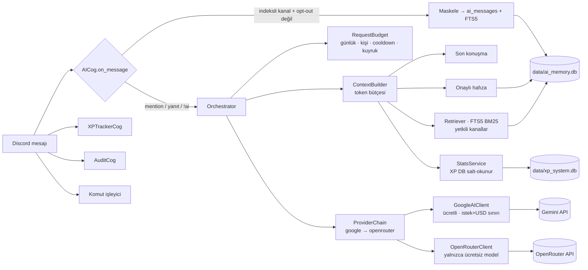

# 🤖 Bot-GAP

<p align="center">
  
</p>

**The Gap** Discord sunucusunun botu. Mesaj ve ses aktivitesine XP verir, seviye rollerini dağıtır, görsel kartlar çizer, kimin kiminle ne kadar seste vakit geçirdiğini tutar ve isteğe bağlı olarak yapay zekâyla sohbet eder.

Bot yalnızca The Gap için yazıldı; herkese açık bir bot olarak yayınlanmak üzere tasarlanmadı.

---

## İçindekiler

- [Özellikler](#-özellikler)
- [Kurulum ve çalıştırma](#-kurulum-ve-çalıştırma)
- [Güncelleme ve yeni sürüm](#-güncelleme-ve-yeni-sürüm)
- [Komutlar](#-komutlar)
- [XP sistemi](#-xp-sistemi)
- [Yapay zekâ sohbet ve hafıza](#-yapay-zekâ-sohbet-ve-hafıza-isteğe-bağlı)
- [Loglama ve hile analizi](#-loglama-ve-hile-analizi)
- [Veri ve yedekleme](#-veri-ve-yedekleme)
- [Geliştirme](#-geliştirme)

---

## ✨ Özellikler

| | |
|---|---|
| 💬 **Mesaj ve ses XP'si** | Mesaj başına rastgele XP (20 sn bekleme), seste 2 dakikada bir XP. Günlük seri ve süreli boost çarpanları. |
| 🏅 **Seviye rolleri** | 19 kademe; XP eşiği geçilince rol otomatik verilir. |
| ⛓️ **Sürgün** | Yöneticilerin XP cezası: süreli ya da kalıcı 0.5x XP, hapishane temalı `!sürgünler` kartı. |
| 🎴 **Görsel kartlar** | `!kart` profil kartı, `!liderlik` ilk 10, `!roller` rol haritası, `!bf` arkadaşlık kartı. |
| 👥 **Arkadaşlık tier'ları** | Birlikte seste geçirilen süreye göre 6 kademe: Tanıdık → Ruh İkizi. |
| 🧠 **Yapay zekâ** *(isteğe bağlı)* | Etiketlenince cevap verir, onaylı kanallardaki sohbetleri hatırlar, XP verisini bilir, internette arar. |
| 🕵️ **Hile dedektörü** | Makro, tekrar mesaj, sessizde XP kasma gibi durumları log kanalına bildirir. |

---

## 🚀 Kurulum ve çalıştırma

### Docker ile (önerilen)

```bash
git clone https://github.com/talhacuce87/Bot-GAP.git
cd Bot-GAP
cp .env.example .env      # en azından DISCORD_TOKEN'ı doldur
docker compose up -d --build
```

- İmaj `python:3.11-slim` tabanlıdır; sisteme ayrıca bir şey kurmak gerekmez.
- Tüm veri (`xp_system.db`, loglar, yedekler) `./data` klasöründedir. Bu klasör konteynere bağlı olduğu için yeniden deploy'da silinmez.
- Loglar: `docker compose logs -f bot-gap`

### Docker olmadan

Python 3.10 veya üstü gerekir (Docker imajı 3.11 kullanır).

```bash
python -m venv .venv
source .venv/bin/activate        # Windows: .venv\Scripts\activate
pip install -r requirements.txt
python Main.py
```

### `.env`

Tam liste ve açıklamalar `.env.example` içinde. Temel ayarlar:

| Değişken | Gerekli | Açıklama |
|---|---|---|
| `DISCORD_TOKEN` | ✅ | Bot token'ı |
| `BOT_PREFIX` | | Komut ön eki (varsayılan `!`) |
| `LOG_CHANNEL_ID` | | Şüpheli hareket ve admin işlemi uyarılarının gideceği kanal |
| `ANNOUNCE_CHANNEL_ID` | | Yeni sürüm açıldığında güncelleme notlarının paylaşılacağı kanal |
| `LOG_FILE_RETENTION_DAYS` / `EVENT_RETENTION_DAYS` | | Log dosyası / olay kaydı saklama süresi (varsayılan 90 / 365 gün) |
| `AI_ENABLED` | | Yapay zekâ eklentisi (varsayılan kapalı). Ayarlar için [Yapay zekâ](#-yapay-zekâ-sohbet-ve-hafıza-isteğe-bağlı) |

Discord Developer Portal'da botun **Server Members Intent** ve **Message Content Intent** izinleri açık olmalı.

---

## 🔄 Güncelleme ve yeni sürüm

**Deploy:**

```bash
git pull
docker compose up -d --build
```

**Yeni sürüm notu yayınlamak için:**

1. `info.py` içinde `BOT_VERSION` ve `LAST_DEPLOY_DATE` değerlerini güncelle.
2. `_build_changelog_embed()` içindeki notları yeni sürüme göre yaz.
3. Deploy et. Bot açılınca sürüm numarası son duyurulandan farklıysa notları `ANNOUNCE_CHANNEL_ID` kanalına **bir kez** paylaşır (`data/announced_version.txt`). Sürüm değişmeden yapılan yeniden başlatmalarda tekrar paylaşmaz.

Herkes son notları `!yenilikler` ile görebilir.

---

## 📌 Komutlar

Tüm komutların kısa listesi Discord'da `!yardim` ile görülebilir.

### Genel

| Komut | Açıklama |
|---|---|
| `!yardim` (`!help`, `!komutlar`) | Komut listesi |
| `!yenilikler` (`!changelog`, `!surum`) | Son sürümün yenilikleri |
| `!feature <istek>` | Özellik önerisi bırakır |
| `!ping` | Bot gecikmesi |

### XP ve kartlar

| Komut | Açıklama |
|---|---|
| `!kart [@üye]` | Seviye, XP, rol ve ilerleme kartı |
| `!xp` | Ayrıntılı XP durumu (metin) |
| `!liderlik` (`!lb`, `!top`) | İlk 10 sıralama kartı |
| `!topxp` | İlk 10 sıralama (metin) |
| `!roller` (`!roles`) | 19 seviye rolünü ve eşiklerini gösteren harita |
| `!streak` | Günlük seri ve çarpan |
| `!sürgünler` | Sürgündekiler, sebepleri ve kalan süreleri (kart) |

### Arkadaşlık

| Komut | Açıklama |
|---|---|
| `!bf [@üye]` | En çok birlikte seste olunan kişi ve tier kartı |
| `!arkadaslar [@üye]` (`!fl`, `!friends`) | En çok vakit geçirilen 10 kişi, tier'larıyla |
| `!tierlar` (`!tiers`) | Tier'lar ve saat eşikleri |

Tier'lar birlikte seste geçirilen süreye göre belirlenir: 🌱 Tanıdık 5 sa · 🤝 Arkadaş 20 sa · 💙 Yakın Arkadaş 50 sa · 💞 Best Friend 100 sa · 🔥 Kanka 250 sa · 👑 Ruh İkizi 500 sa.

### Yönetici

| Komut | Açıklama |
|---|---|
| `!xpekle @üye <miktar> <sebep>` | XP ekler |
| `!xpçıkar @üye <miktar> <sebep>` (`!xpcikar`, `!xpsil`) | XP çıkarır |
| `!xpayarla @üye <miktar> <sebep>` | Toplam XP'yi ayarlar (mesaj/ses oranı korunur) |
| `!boost @üye <çarpan> [saat] <sebep>` | Süreli XP çarpanı (1–10x, en fazla 720 saat) |
| `!sürgün @üye <süre\|kalıcı> <sebep>` (`!surgun`) | Üyeyi sürgüne gönderir; bkz. [Sürgün](#sürgün) |
| `!sürgünsonlandır @üye` (`!surgunsonlandir`) | Sürgünü erken bitirir |
| `!xpsenkronize` | Tüm üyelerin seviye rollerini XP'lerine göre düzeltir |
| `!yedekle` (`!backup`) | Veritabanının anlık yedeğini alır |

XP komutlarında sebep zorunludur (en az 5 karakter) ve her işlem olay kaydına yazılır. Yapay zekâ komutları için [ilgili bölüme](#komutlar) bak.

---

## 📈 XP sistemi

| Kaynak | Kural |
|---|---|
| **Mesaj** | Mesaj başına rastgele **3–8 XP**, kişi başı **20 sn** bekleme. Komutlar XP vermez. |
| **Ses** | **2 dakikada 1 XP**. Kanalda en az **2 geçerli üye** olmalı. Sağırlaştırılmış (deafen) üyeler, botlar ve AFK kanalı sayılmaz; mikrofon kapalı olmak XP'yi engellemez. |
| **Günlük seri** | O gün yazılan ilk mesaj seriyi ilerletir. Her seri günü mesaj XP'sine **+%2** ekler (en fazla **+%50**). |
| **Seri ödülleri** | 7 gün +50 · 14 gün +120 · 30 gün +300 · 60 gün +700 · 100 gün +1500 XP |
| **Boost** | Yöneticinin verdiği süreli çarpan; mesaj ve ses XP'sine uygulanır. |
| **Sürgün** | Sürgündeki üye tüm XP'yi sabit **0.5x** kazanır; boost ve seri çarpanı yok sayılır. |

Seviye, toplam XP'nin geçtiği rol eşiğidir: 0, 150, 400, 800, 1.400, 2.300, 3.500, 5.200, 7.600, 10.500, 14.500, 19.500, 25.500, 32.500, 40.000, 100.000, 250.000, 500.000 ve 1.000.000 XP (19 seviye). Eşik geçilince rol otomatik verilir; `!roller` haritayı gösterir.

### Sürgün

Yöneticilerin XP cezası. `!sürgün @üye <süre> <sebep>` ile verilir.

- **Süre:** `30dk`, `12sa`, `3g`, `1hafta`, `1ay`, birleşik `1g12sa` ya da sadece sayı (saat). En fazla 365 gün. `kalıcı` yazılırsa bir yönetici `!sürgünsonlandır` ile kaldırana kadar sürer.
- **Ceza:** Mesaj ve ses XP'si sabit **0.5x** olur; aktif boost ve seri çarpanı hesaba katılmaz. Küsurat birikir (ör. seste 4 dakikada 1 XP).
- **Seri donar:** Sürgünde seri ne ilerler ne bozulur, ödül de vermez. Ceza bitince kaldığı günden ve çarpandan devam eder.
- **Bitiş:** Süre dolunca bot dakikada bir kontrol edip cezayı kendisi kaldırır ve sürgünün verildiği kanalda haber verir. Erken bitirmek için `!sürgünsonlandır @üye`.
- Zaten sürgündeki birine tekrar `!sürgün` yazılırsa süre ve sebep güncellenir.
- `!sürgünler` herkesin görebildiği hapishane temalı bir kart çizer: sabıka fotoğrafı, sebep, sürgün eden yönetici, kalan süre ve çekilen cezanın çubuğu (kalıcılar kırmızı).
- Sürgün verme, güncelleme ve bitirme işlemleri olay kaydına ve log kanalına yazılır.

---

## 🧠 Yapay zekâ sohbet ve hafıza (isteğe bağlı)

Bot, Google AI Studio (Gemini, ücretli) ve/veya OpenRouter'ın **ücretsiz** modelleriyle konuşabilir ve onaylı kanallardaki sohbetleri hatırlayabilir. `AI_ENABLED=false` (varsayılan) iken hiçbir AI kodu yüklenmez.

### Kurulum

1. Bir sağlayıcı anahtarı al: https://openrouter.ai/keys (ücretsiz modeller) ve/veya Google AI Studio (ücretli).
2. `.env` dosyasına ekle:
   ```env
   AI_ENABLED=true
   OPENROUTER_API_KEY=sk-or-v1-...
   OPENROUTER_MODEL=google/gemma-4-31b-it:free
   OPENROUTER_FALLBACK_MODEL=nvidia/nemotron-3-super-120b-a12b:free,openrouter/free
   # İsteğe bağlı, ücretli:
   GOOGLE_AI_API_KEY=...
   ```
3. Botu yeniden deploy et.
4. Sunucuda bir yönetici, hafızayı açmak istediği kanalda `!aiayar kanal ekle` yazar. Bot kanala bir bilgilendirme mesajı bırakır.
5. `!aidurum` ile modeli ve kotayı kontrol et.

### Komutlar

**Kullanıcı:**
- Sohbet: `@Bot-GAP <mesaj>` · `!ai <mesaj>` · `/ara <soru>` / `!ara <soru>` (internet araması, cevap yalnızca sana)
- Hafıza: `!hatirla <konu>` (LLM kotası harcamaz) · `!hafizam` (DM) · `!hafizaekle <bilgi>` · `!onayla <id>` · `!unut <id>` · `!unuttur [onay]`
- Diğer: `!aigizlilik [ac|kapat]` · `!ani <metin> [@üyeler]` · `!anilar` · `!aiyardim` · `!aidurum`

**Yönetici:** `!aiayar` (durum) · `!aiayar ac|kapat` · `!aiayar kanal ekle|cikar [#kanal]` · `!aiayar mod mention|command` · `!aiayar cooldown <sn>` · `!aiayar saklama <gün>` · `!aiayar bakim` · `!aiayar yedekle`. Tüm ayar değişiklikleri olay kaydına `admin_ai_*` olarak yazılır.

"Kim en yüksek seviyede?", "seviyem kaç?", "best friend'im kim?" gibi sorular XP veritabanından **salt-okunur** cevaplanır; model kullanılamazsa bu veriler doğrudan gösterilir.

### Sağlayıcılar ve maliyet

**Google AI Studio (ücretli):** `GOOGLE_AI_API_KEY` verilince birincil sağlayıcı olur (`AI_PROVIDER_ORDER=google,openrouter`); hata, kota ya da bütçe dolunca OpenRouter'a düşülür. Faturalandırması açık bir projenin anahtarıyla **her istek ücretlendirilir**.

- Varsayılan model `gemini-3.8-flash`: 1M giriş/çıkış token başına $0.75 / $3.75 (1 Ocak 2027'den itibaren $1.50 / $7.50). Tipik bir cevap ~$0.0015–0.0025. Gemini 3+ modellerinde düşünme kapatılamaz, `minimal` seviyede çalışır ve düşünme tokenları çıktı olarak ücretlendirilir.
- Daha ucuz alternatifler: `gemini-3.1-flash-lite` (~$0.0005/cevap), `gemini-2.5-flash-lite` (~$0.0002/cevap, düşünme kapalı).
- **Sert günlük sınırlar** (UTC gün, yeniden başlatmada korunur): `GOOGLE_AI_DAILY_REQUEST_BUDGET` (varsayılan 1000) ve `GOOGLE_AI_DAILY_COST_LIMIT_USD` (varsayılan $5). Biri dolunca Google o gün kullanılmaz.
- Maliyet, yanıttaki token sayıları × `GOOGLE_AI_PRICE_*_PER_M` ile **tahmin** edilir (Google bu uç noktada ücret bildirmez). Kesin fatura için Google Cloud Console → Billing; orada bir **bütçe uyarısı** kurman önerilir.
- Hatalar: dakikalık 429 → `retryDelay` kadar bekleyip tekrar (30 sn'den uzunsa yedeğe geçer); günlük kota 429 → model 15 dk soğumaya alınır; geçersiz anahtar → Google 30 dk devre dışı.

**OpenRouter (ücretsiz):**

- Varsayılan model `google/gemma-4-31b-it:free` (akıl yürütme kapalı, Türkçesi iyi). `openrouter/free` her istekte rastgele bir ücretsiz modele gider; bunların bazıları düşünme metnini cevaba sızdırdığı için yalnızca yedek olarak önerilir. Bot akıl yürütmeyi kapatır (`AI_REASONING_EFFORT=none`), `<think>` bloklarını siler ve düşünme metni gibi görünen cevapları göndermeden yeniden dener.
- Bot açılışta ve 6 saatte bir model fiyatlarını doğrular. Fiyatı `0` olmayan model (değişken fiyatlı `openrouter/auto` dahil) `AI_ALLOW_PAID_MODELS=true` olmadıkça **asla** çağrılmaz. İsteklere `provider.max_price = 0` eklenir; yanıtta ücret bildirilirse sağlayıcı kapatılır.
- Sağlayıcı yoğunken (429) aynı model tekrar denenmez: model 2 dk (ya da `Retry-After` kadar, en çok 15 dk) soğumaya alınır ve sıradaki yedeğe geçilir. Bu yüzden yedek olarak farklı sağlayıcıdaki bir model seçmek önemlidir.
- Ücretsiz kota (2026-10 itibarıyla): dakikada 20, günde 50 istek (hesaba toplam 10$+ kredi yüklenmişse günde 1000). `AI_DAILY_REQUEST_BUDGET` bunun altında tutulmalı.
- Ücretsiz modeller zamanla kaldırılabilir; `!aidurum` hata gösterirse modeli güncelle.

### Araçlar ve internet araması

Gemini kullanılırken model, isteğe göre hangi aracı çağıracağına kendisi karar verir (en fazla 4 tur, her tur bütçeden düşer):

| Araç | Ne yapar |
|---|---|
| `get_server_info`, `list_roles`, `get_role_members`, `list_channels`, `get_voice_activity`, `get_member_profile` | Discord bilgisi (yalnızca soranın görebildiği) |
| `get_leaderboard`, `get_member_stats`, `get_best_friend` | XP, seviye, seri, ses ve arkadaşlık verisi (salt-okunur) |
| `search_chat_history` | Hafızası açık, yetkili kanallarda geçmiş arama (kaynak linkleriyle) |
| `save_user_memory` | Kullanıcı açıkça "hatırla" dediyse kaydeder; aksi halde yalnızca aday |
| `web_search` | Google Search; cevap yalnızca soran kişiye iletilir |

Araç desteklemeyen modellere (OpenRouter yedekleri) düşülürse uygulama soruya göre veriyi önceden toplayıp modele verir. `AI_TOOLS_ENABLED=false` ile araçlar kapatılabilir.

- **`/ara`:** Google'ın [Gemini API koşulları](https://ai.google.dev/gemini-api/terms) arama sonuçlarının yalnızca soran kişiye gösterilmesini ve saklanmamasını şart koşar. Bu yüzden slash komutunda cevap gizli mesaj, prefix komutunda DM olarak gelir; herkese açık kanala yazılmaz ve hafızaya kaydedilmez.
- Arama ücreti: ayda 5000 arama ücretsiz, sonrası $14 / 1000 arama. Bot her aramayı `GOOGLE_AI_SEARCH_PRICE_PER_1000` ile USD sınırına ekler. Günlük sınır: `GOOGLE_AI_DAILY_SEARCH_BUDGET` (varsayılan 100).
- Slash komutlarının Discord'da görünmesi için bot bir kez `AI_SLASH_SYNC=true` ile başlatılmalı.
- Çevrimiçi üye sayısı bilinemez (botta Presence Intent yok).

### Gizlilik ve saklama

- Kanal indeksleme **varsayılan kapalı**. Yalnızca `!aiayar kanal ekle` ile açılan kanallardaki, komut ve bot olmayan mesajlar saklanır. DM'ler asla saklanmaz.
- E-posta, telefon, IBAN, kart numarası, TC kimlik, token/API anahtarı ve "şifrem: …" kalıpları kaydedilmeden önce `[gizlendi]` ile maskelenir.
- Geçmiş arama **o anki** Discord izinlerine göre yapılır: kanal hem soran üye tarafından okunabilmeli hem de ya cevabın verildiği kanal olmalı ya da @everyone'a açık olmalı. Böylece özel kanal içeriği başka bir kanala sızmaz.
- Silinen mesajın içeriği hemen silinir. Tek kaynağı silinen, onaylanmamış hafızalar iptal edilir.
- Otomatik çıkarılan bilgiler ("en sevdiğim oyun X") yalnızca **aday** olur; kullanıcı `!onayla` demedikçe kullanılmaz.
- Sağlayıcıya yalnızca o istek için seçilmiş kısa bağlam gönderilir. Sağlayıcılar veriyi kendi koşullarına göre işleyebilir (ücretsiz katmanlarda eğitim amaçlı kullanım dahil olabilir).
- Mesajlar varsayılan 30 gün saklanır (sunucu bazında değiştirilebilir); bakım 6 saatte bir çalışır.
- Not: `AuditCog` tüm komutların ilk 200 karakterini olay kaydına yazar; bu `!ai` sorularını da kapsar (`EVENT_RETENTION_DAYS` ile sınırlı).

### Mimari



`ai/` paketi: `config` (env) · `storage` (SQLite) · `migrations` · `openrouter` / `google` (sağlayıcılar) · `providers` (zincir) · `budget` (kota) · `guard` (güvenlik/gizlilik) · `retrieval` (FTS5) · `context` (prompt) · `memory` (hafıza politikası) · `stats` (Bot-GAP verisi) · `persona` · `orchestrator` · `cog` (Discord). Botun kişiliği `persona/default.md` dosyasından düzenlenebilir.

<details>
<summary><b>Tüm AI ortam değişkenleri</b></summary>

| Değişken | Varsayılan | Açıklama |
|---|---|---|
| `AI_ENABLED` | `false` | Eklentiyi aç/kapat |
| `GOOGLE_AI_API_KEY` | – | Google AI Studio anahtarı (loglanmaz; **ücretli olabilir**) |
| `GOOGLE_AI_MODEL` / `GOOGLE_AI_FALLBACK_MODEL` | `gemini-3.8-flash` / – | Google modeli ve virgülle ayrılmış yedekleri |
| `GOOGLE_AI_DAILY_REQUEST_BUDGET` / `GOOGLE_AI_DAILY_COST_LIMIT_USD` | `1000` / `5` | Google için sert günlük sınırlar |
| `GOOGLE_AI_PRICE_INPUT_PER_M` / `GOOGLE_AI_PRICE_OUTPUT_PER_M` | `0.75` / `3.75` | Maliyet tahmini için birim fiyat (USD/1M token) |
| `GOOGLE_AI_MAX_OUTPUT_TOKENS` | `800` | Google yanıt sınırı (düşünme dahil) |
| `GOOGLE_AI_REASONING_EFFORT` | `auto` | `auto` / `none` / `minimal` / `low` … / `off` (gönderme) |
| `AI_PROVIDER_ORDER` | `google,openrouter` | Sağlayıcı sırası |
| `AI_WEB_SEARCH_ENABLED` | `true` | `/ara` internet araması (Google anahtarı gerekir) |
| `GOOGLE_AI_DAILY_SEARCH_BUDGET` / `GOOGLE_AI_SEARCH_PRICE_PER_1000` | `100` / `14` | Günlük arama sınırı ve arama başı maliyet tahmini |
| `AI_DISCORD_INFO_ENABLED` | `true` | Sunucu/rol/kanal/ses/üye bilgisini modele ver |
| `AI_TOOLS_ENABLED` | `true` | Modelin araç çağırmasına izin ver (Gemini) |
| `OPENROUTER_API_KEY` | – | OpenRouter anahtarı (loglanmaz) |
| `OPENROUTER_MODEL` | `google/gemma-4-31b-it:free` | Birincil model |
| `OPENROUTER_FALLBACK_MODEL` | – | Virgülle ayrılmış yedek modeller (yalnızca ücretsizler) |
| `AI_ALLOW_PAID_MODELS` | `false` | Ücretli modellere izin |
| `AI_ENFORCE_ZERO_PRICE` | `true` | İsteğe `provider.max_price=0` ekle |
| `AI_MAX_OUTPUT_TOKENS` | `350` | Yanıt token sınırı |
| `AI_CONTEXT_TOKEN_BUDGET` | `3000` | Yaklaşık prompt bütçesi |
| `AI_MAX_CONCURRENT_REQUESTS` / `AI_MAX_QUEUE_SIZE` | `1` / `4` | Eşzamanlılık ve bekleme kuyruğu |
| `AI_REQUEST_TIMEOUT_SECONDS` / `AI_TOTAL_DEADLINE_SECONDS` | `45` / `90` | Deneme ve toplam süre sınırı |
| `AI_MAX_RETRIES` / `AI_MAX_RETRY_WAIT_SECONDS` | `2` / `30` | Yeniden deneme sayısı ve en uzun bekleme |
| `AI_REASONING_EFFORT` | `none` | `none` = akıl yürütme kapalı (önerilen); `low`/`medium`/`high` = açık ama gizli; boş = gönderme |
| `AI_RESPONSE_MODE` | `mention` | `mention` veya `command` (sadece `!ai`) |
| `AI_MEMORY_ENABLED` | `true` | Uzun süreli hafıza |
| `AI_INDEXING_DEFAULT` | `false` | `true` → tüm metin kanalları varsayılan indekslenir (önerilmez) |
| `AI_MESSAGE_RETENTION_DAYS` | `30` | Mesaj saklama (sunucu bazında `!aiayar saklama`) |
| `AI_CANDIDATE_RETENTION_DAYS` | `14` | Onaylanmamış aday hafıza ömrü |
| `AI_DAILY_REQUEST_BUDGET` | `35` | OpenRouter günlük istek (UTC; her HTTP denemesi sayılır) |
| `AI_USER_DAILY_REQUEST_LIMIT` | `0` | Kişi başı günlük cevap sınırı (0 = sınırsız) |
| `AI_CHANNEL_COOLDOWN_SECONDS` / `AI_USER_COOLDOWN_SECONDS` | `1` / `1` | Kanal / kişi başı bekleme (sn) |
| `AI_RECENT_CONTEXT_MESSAGES` | `25` | Kısa süreli bağlam penceresi |
| `AI_SEARCH_RESULTS` / `AI_FINAL_PASSAGES` / `AI_NEIGHBOR_MESSAGES` | `10` / `5` / `2` | Geçmiş arama sınırları |
| `AI_SLASH_SYNC` | `false` | Açılışta slash komutlarını kaydet |
| `AI_DB_PATH` / `AI_PERSONA_DIR` | `data/ai_memory.db` / `persona/` | Yol değiştirme |

</details>

<details>
<summary><b>Sorun giderme</b></summary>

| Belirti | Neden / çözüm |
|---|---|
| "AI yapılandırılmamış" | `OPENROUTER_API_KEY` boş |
| "yapılandırma hatası… devre dışı" | Anahtar 401/403 aldı; 30 dk sonra ya da yeniden başlatınca tekrar denenir. Anahtarı kontrol et |
| "ücretsiz olarak doğrulanamadı" | Model ücretli, değişken fiyatlı ya da listede yok; `:free` bir model seç |
| "Bugünlük … kota doldu" | Yerel bütçe ya da OpenRouter günlük kotası; UTC gece yarısı sıfırlanır |
| "Model boş yanıt döndü" | Model düşünmeye token harcadı ya da düşünme metni sızdırdı. `AI_REASONING_EFFORT=none` olduğundan ve `OPENROUTER_MODEL`'in `openrouter/free` olmadığından emin ol |
| Sürekli 404 / "No endpoints" | Model kaldırılmış olabilir ya da `AI_ENFORCE_ZERO_PRICE=false` dene |
| `!hatirla` sonuç vermiyor | Kanal indekslenmiyor (`!aidurum`) ya da farklı kelimelerle konuşulmuş |
| AI veritabanı hatası (`!aiayar`) | `data/` izinlerini ve disk alanını kontrol et |

Loglar `data/logs/bot.log` içinde (`gap.ai.*`). API anahtarları ve prompt içerikleri loglanmaz.

**Geri alma:** Hızlı yol `.env`'de `AI_ENABLED=false` yapıp `docker compose up -d` (AI verisi diskte kalır). `data/ai_memory.db*` dosyaları XP verisinden bağımsızdır, istenirse silinebilir.

</details>

<details>
<summary><b>Bilinen sınırlar</b></summary>

- Geçmiş arama sözcükseldir (FTS5 + Türkçe harf katlama + temkinli ek kırpma). Eşanlamlılar ("maç" ↔ "karşılaşma") bulunmaz.
- Token sayımı yaklaşıktır (~3 karakter/token).
- Thread'ler ancak thread'in kendisi `!aiayar kanal ekle` ile açılırsa indekslenir.
- Hafıza çıkarımı birkaç basit kalıpla sınırlıdır ve şakayı ayırt edemez (bu yüzden aday olarak kalır).
- Ücretsiz modellerin kalitesi ve kotası OpenRouter'a bağlıdır ve değişebilir.
- Bellek: AI kapalı ~54 MB, AI açık boşta ~57 MB (gateway bağlantısı olmadan ölçüldü). Gerçek sunucuda üye önbelleği nedeniyle daha yüksek olur; hedef toplam 150–350 MB.
- Planlanan: semantik arama, LLM ile hafıza özetleme. Sesli kanal ve görsel girdi kapsam dışı.

</details>

---

## 🕵️ Loglama ve hile analizi

**Log dosyası:** `data/logs/bot.log`. Her gece döner, 90 gün saklanır.

**Olay kaydı (`activity_log` tablosu):** Mesaj metadatası (içerik değil; uzunluk ve hash), XP kazanımları, seviye ve rol değişimleri, ses giriş/çıkış/mute/yayın, üye giriş/çıkış (hesap yaşıyla), mesaj silme/düzenleme, komutlar ve hatalar, tüm admin işlemleri ve şüpheli hareket bayrakları.

**Canlı dedektör** (`LOG_CHANNEL_ID` kanalına bildirir):

| Bayrak | Anlamı |
|---|---|
| `tekrar_mesaj` | Aynı içerik tekrar tekrar yazılıyor |
| `makro_zamanlama` | Mesaj aralıkları neredeyse sabit (makro / self-bot) |
| `cooldown_kasma` | Mesajlar tam XP beklemesi dolunca atılıyor |
| `sessiz_ses_kasma` | Kanaldaki herkes 30+ dk mikrofonu kapalı ses XP'si alıyor |
| `yeni_hesap_ses` | 14 günden yeni hesap ses XP'si alıyor |

**Geçmişe dönük analiz** (sunucuda):

```bash
docker exec bot-gap python analysis.py --guild <sunucu_id> --days 30
docker exec bot-gap python analysis.py --guild <sunucu_id> --user <üye_id> --days 90
docker exec bot-gap python analysis.py --guild <sunucu_id> --legacy   # kayıt öncesi toplam verilerden
```

---

## 💾 Veri ve yedekleme

`data/` klasöründekiler:

| Dosya | İçerik |
|---|---|
| `xp_system.db` | XP, seri, boost, ses süreleri, olay kaydı (SQLite WAL) |
| `ai_memory.db` | Yapay zekâ hafızası (yalnızca AI açıksa) |
| `logs/` | Log dosyaları |
| `backups/` | Otomatik ve elle alınan yedekler |

- XP veritabanının anlık yedeği: `!yedekle` → `data/backups/xp_system_YYYYMMDD.db`.
- AI veritabanı her gün `data/backups/ai_memory_YYYYMMDD.db` olarak yedeklenir (son 7 tutulur); elle: `!aiayar yedekle`.
- AI veritabanını geri yükleme: botu durdur → `cp data/backups/ai_memory_YYYYMMDD.db data/ai_memory.db` → `rm -f data/ai_memory.db-wal data/ai_memory.db-shm` → botu başlat.

---

## 🛠️ Geliştirme

### Proje yapısı

```
Bot-GAP/
├── Main.py              # Giriş noktası; cog'ları yükler
├── xp.py                # XP olayları, ses döngüsü, XP komutları
├── xproles.py           # Seviye eşikleri ve rol yönetimi
├── database.py          # Asenkron SQLite (aiosqlite, WAL)
├── usercard.py          # !kart
├── leaderboard.py       # !liderlik ve !roller
├── rolescard.py         # Rol haritası kartı
├── bestfriend.py        # Ses çifti takibi, tier'lar, !bf / !arkadaslar
├── exile.py             # !sürgün XP cezası ve !sürgünler kartı
├── cardutils.py         # Kartların ortak Pillow yardımcıları
├── font_utils.py        # Emoji ve desteklenmeyen karakter temizleme
├── info.py              # !yardim, !yenilikler, !ping, sürüm duyurusu
├── audit.py             # Olay kaydı, canlı hile dedektörü, analiz komutları
├── activitylog.py       # Log dosyası kurulumu ve olay yazıcısı
├── analysis.py          # Geçmişe dönük hile analizi (CLI)
├── ai/                  # İsteğe bağlı yapay zekâ eklentisi
├── persona/default.md   # Düzenlenebilir bot kişiliği
├── tests/               # pytest testleri
├── assets/              # Banner, logo, DejaVu fontları
├── requirements.txt     # Bağımlılıklar
├── requirements-dev.txt # Test bağımlılıkları
├── Dockerfile
└── docker-compose.yaml
```

### Teknolojiler

Python 3.11 · discord.py 2.7 · Pillow · aiosqlite · httpx

### Testler

```bash
pip install -r requirements-dev.txt
python -m pytest
```

Testler ağa ve Discord'a bağlanmaz.
